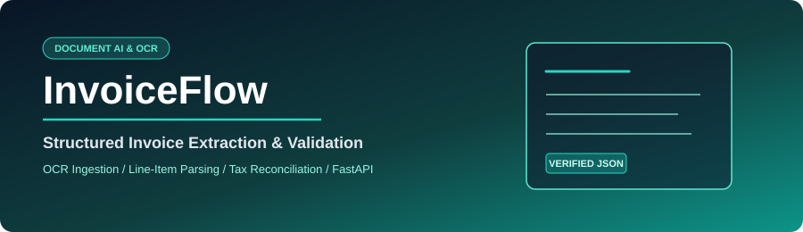

<p align="center">
  
</p>

# InvoiceFlow — Structured Invoice Extraction Pipeline

**InvoiceFlow** is a production-grade invoice document processing and structured data extraction system built with Python, Pydantic, and FastAPI. Unlike basic regex-only scripts or raw notebooks, InvoiceFlow provides modular ingestion (PDF, images via OCR, raw text), multi-currency schema normalization, automated line-item reconciliation, confidence scoring, REST API endpoints, and an automated accuracy benchmark suite.

## Why This Upgrades Basic Invoice Extraction Repos

- **Clean `src/` Package Architecture**: Separates ingestion (`extractor.py`), field parsing (`parser.py`), financial reconciliation (`validator.py`), API serving (`api.py`), and benchmarking (`evaluator.py`).
- **Automated Math & Tax Reconciliation**: Cross-checks `sum(line_items) + tax - discount == total_amount` and flags discrepancies automatically.
- **Multi-Format Input Support**: Handles raw text, native digital PDFs (`pypdf`), and scanned images (`pytesseract` + `Pillow`) with graceful fallbacks.
- **Typed Pydantic Schemas**: Guarantees clean JSON output (`vendor_name`, `invoice_number`, `invoice_date`, `due_date`, `currency`, `line_items`, `subtotal`, `tax_amount`, `total_amount`, `confidence_score`).
- **FastAPI Service + Swagger UI**: Production endpoints (`/health`, `/extract/text`, `/extract/file`, `/evaluate`) ready for integration.
- **Automated CI & Test Suite**: Complete `pytest` suite and GitHub Actions workflow.

## Architecture

```
Invoice Input (PDF / Image / Text)
       │
       ▼
[DocumentIngestor] ──► Native PDF Text / Tesseract OCR / Raw Text
       │
       ▼
[InvoiceParser]    ──► Header Fields + Line Items + Currency Detection
       │
       ▼
[InvoiceValidator] ──► Subtotal/Tax/Total Reconciliation + Confidence Score
       │
       ▼
FastAPI JSON Response (/extract/text, /extract/file)
```

## Quick Start

```bash
# 1. Install package and test dependencies
pip install -e ".[dev]"

# 2. Run the test suite
pytest

# 3. Start the FastAPI server
uvicorn invoiceflow.api:app --reload
```

Open `http://127.0.0.1:8000/docs` in your browser to test interactive invoice extraction via Swagger UI.
